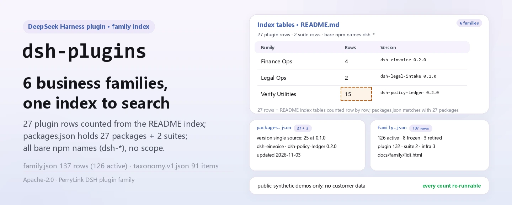
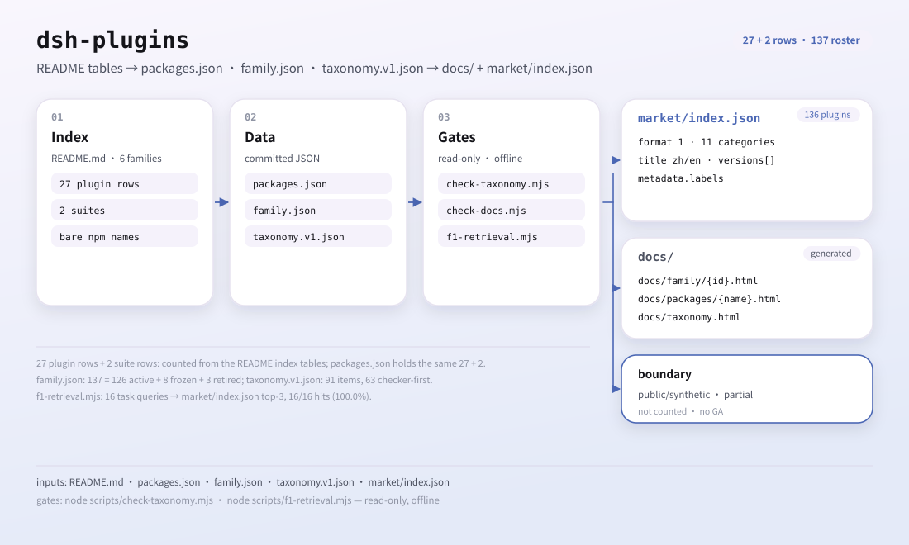
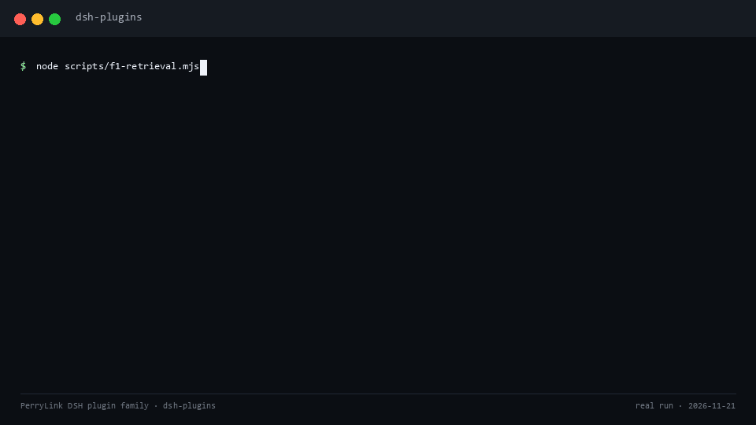

<picture>
  <source media="(prefers-color-scheme: dark)" srcset="docs/assets/dsh-plugins-hero-en-dark.webp">
  
</picture>

# PerryLink DSH domain plugins

**El índice de la familia de plugins DSH de PerryLink: 27 paquetes de dominio + 2 suites de instalación en un solo comando, en 6 familias de negocio y con nombres npm sin scope (`dsh-*`).**

*Esta es la entrada en español; la tabla completa con los 27 plugins, sus versiones y comandos de instalación está en el [README.md](README.md) en chino, y la versión completa en inglés en [README.en.md](README.en.md).*

[English](README.en.md) · [简体中文](README.md) · [Español](README-es.md) · [Português](README-pt.md) · [हिन्दी](README-hi.md)

<picture>
  <source media="(prefers-color-scheme: dark)" srcset="docs/assets/dsh-plugins-flow-v5-dark.svg">
  
</picture>

*Estructura: tablas del índice → JSON versionados → docs/ y market/index.json → puertas de solo lectura. Las etiquetas del diagrama son los nombres reales de archivos y scripts, así que la misma imagen sirve para los cinco idiomas.*

*Animado: el stdout real del experimento de recuperación de solo lectura del repositorio, `node scripts/f1-retrieval.mjs` (repetición del 2026-11-21) — 16 preguntas sobre los 136 plugins de `market/index.json`, tasa de acierto 16/16 (100,0 %). Sin red y sin llamadas al modelo.*

## Instalación

Añade un plugin por su nombre npm: `dsh plugin --profile <profile> add dsh-ghg`. Requiere DSH `>=0.2.1-rc.3 <0.3.0` y Node `>=24.9 <25`.

## Índice

Los 27 paquetes de dominio se agrupan en 6 familias de negocio: Finance Ops (`dsh-einvoice`, `dsh-bankrec`, `dsh-ap-three-way`, `dsh-travel-recon`), Legal Ops (`dsh-legal-intake`, `dsh-legal-clause`), ESG & Quality (`dsh-ghg`, `dsh-qms-capa`), Trade & Logistics (`dsh-hs-candidate`, `dsh-freight-audit`), Docs & Models (`dsh-docx-redline`, `dsh-ifc-qto`) y Verify Utilities (15 paquetes). La tabla completa, con el enlace de cada paquete y su versión, está en el [README.md](README.md).

## Artículo de escenario

- [De facturas a viajes: cómo funciona una cadena de operaciones financieras revisable](https://perrylink.github.io/dsh-plugins/articles/finops-suite.html)

## Suites en un solo comando

Dos suites instalan el conjunto de una vez: `dsh-finops-suite` (`0.1.0-alpha.10`: `dsh-einvoice` + `dsh-bankrec` + `dsh-ap-three-way` + `dsh-travel-recon`) y `dsh-contract-suite` (`0.1.0-alpha.9`: `dsh-legal-intake` + `dsh-legal-clause`). Los comandos y los mirrors de Gitee / GitCode están en el [README.md](README.md).

## Plataformas

GitHub ([PerryLink/dsh-plugins](https://github.com/PerryLink/dsh-plugins)), npm ([~perrylink](https://www.npmjs.com/~perrylink)), Gitee ([perrylink/dsh-plugins](https://gitee.com/perrylink/dsh-plugins)), GitCode ([PerryLink/dsh-plugins](https://gitcode.com/PerryLink/dsh-plugins)) y la documentación en [perrylink.github.io/dsh-plugins](https://perrylink.github.io/dsh-plugins/).

## Notas de nombres

Todos los paquetes usan nombres npm sin scope. El nombre original `dsh-eval-harness` lo ocupa otro publicador, así que el proyecto ahora es **`dsh-eval-pack`** y el paquete con scope `@perrylink/dsh-eval-harness` está deprecado y apunta al nuevo.

## Límites

Todo es public/synthetic, partial, `counted=false` y sin GA; no se aceptan datos de clientes en el repositorio, las pruebas ni los fixtures (solo muestras públicas MIT/Apache), y alpha nunca se describe como production-ready, validado por clientes o de precisión demostrada. Apache-2.0; véase [PUBLIC-ONLY-BOUNDARY.md](PUBLIC-ONLY-BOUNDARY.md).
