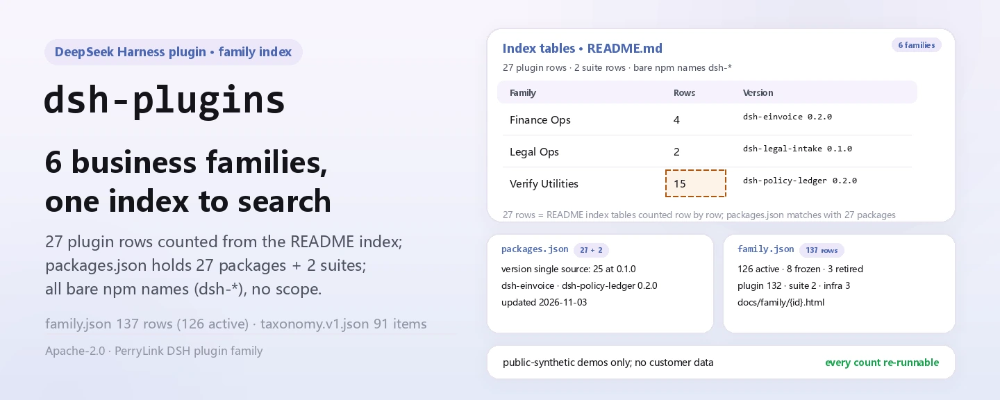
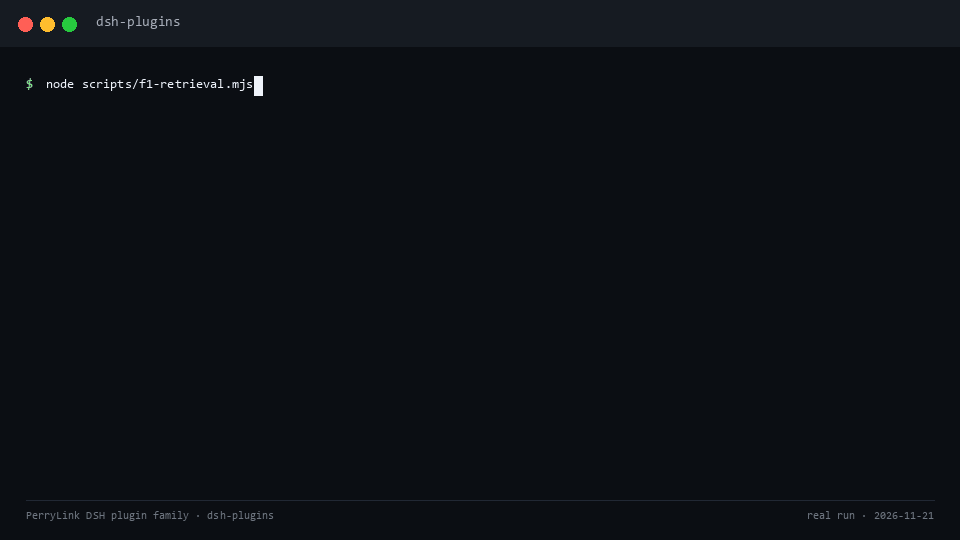
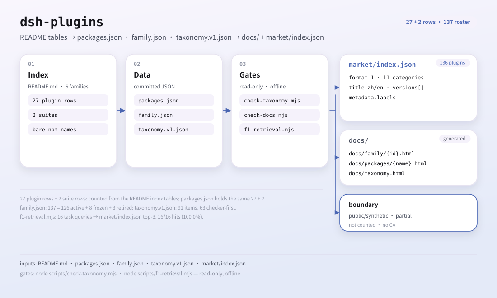

<div align="center">

<picture>
  <source media="(prefers-color-scheme: dark)" srcset="docs/assets/dsh-plugins-hero-en-dark.webp">
  
</picture>

# PerryLink DSH डोमेन प्लगइन्स

**PerryLink DSH प्लगइन परिवार का सूचकांक: 6 व्यावसायिक परिवारों में 27 डोमेन पैकेज + 2 वन-कमांड सूट, सभी बिना स्कोप के बेयर npm नाम (`dsh-*`) पर।**

*README.md की सूचकांक तालिकाएँ प्रवेश-बिंदु हैं, `packages.json` और `family.json` डेटा-स्रोत हैं, और `market/index.json` वही है जो DSH Desktop का Discover टैब पढ़ता है; यह रिपॉज़िटरी केवल सार्वजनिक सिंथेटिक डेमो सूचीबद्ध करती है — कोई ग्राहक डेटा नहीं और उत्पादन-तैयार होने का कोई दावा नहीं।*

[English](README.en.md) · [简体中文](README.md) · [Español](README-es.md) · [Português](README-pt.md) · [हिन्दी](README-hi.md)

[](LICENSE)
[](https://gitee.com/perrylink/dsh-plugins)

</div>

> **Status: alpha / public-synthetic / partial / not counted / not GA.** पूरा परिवार-समूहन [FAMILY.md](https://github.com/PerryLink/PerryLink/blob/main/FAMILY.md) में है; चार-अक्ष कर-वर्गीकरण [TAXONOMY.md](TAXONOMY.md) में है; 137 पंक्तियों (126 सक्रिय) का फ़िल्टर करने योग्य दृश्य [taxonomy.html](docs/taxonomy.html) में है। यह सूचकांक केवल सार्वजनिक सिंथेटिक डेमो सूचीबद्ध करता है; कोई ग्राहक प्रमाण, ग्राहक डेटा या उत्पादन-तैयार होने का दावा नहीं। SKU-11/14 स्थायी रूप से DROP हैं।

6 व्यावसायिक परिवारों में संगठित 27 DSH डोमेन प्लगइन, सभी **बिना स्कोप के बेयर npm नाम** (`dsh-*`) पर।

## इंस्टॉल



*एनिमेटेड: रिपॉज़िटरी के अपने केवल-पढ़न रिट्रीवल प्रयोग `node scripts/f1-retrieval.mjs` का असली stdout (2026-11-21 को दोबारा रन) — `market/index.json` के 136 प्लगइन पर 16 कार्य-प्रश्न, हिट दर 16/16 (100.0%)। कोई नेटवर्क नहीं, कोई मॉडल कॉल नहीं।*

```sh
dsh plugin --profile <profile> add dsh-ghg
```

DSH `>=0.2.1-rc.3 <0.3.0` और Node `>=24.9 <25` आवश्यक हैं।

<picture>
  <source media="(prefers-color-scheme: dark)" srcset="docs/assets/dsh-plugins-flow-v5-dark.svg">
  
</picture>

*संरचना: सूचकांक तालिकाएँ → कमिट किया गया JSON → docs/ और market/index.json → केवल-पढ़न गेट। चित्र के लेबल असली फ़ाइल और स्क्रिप्ट नाम हैं, इसलिए एक ही चित्र पाँचों भाषाओं के लिए है।*

## सूचकांक

### वित्त (Finance Ops)

| पैकेज | उद्देश्य | संस्करण | इंस्टॉल |
|---|---|---:|---|
| [`dsh-einvoice`](https://github.com/PerryLink/dsh-einvoice) | फ़ाइल-स्तर पर चीन के ई-इनवॉइस (OFD/XML) का अंतर्ग्रहण, पार्सिंग, डुप्लीकेट हटाना और स्थानीय संग्रह। | `0.2.0` | `dsh plugin --profile <profile> add dsh-einvoice` |
| [`dsh-bankrec`](https://github.com/PerryLink/dsh-bankrec) | बैंक स्टेटमेंट / GL / CAMT.053 / MT940 अंतर्ग्रहण, मिलान और तीन-विवरण कार्यपत्र। | `0.1.0` | `dsh plugin --profile <profile> add dsh-bankrec` |
| [`dsh-ap-three-way`](https://github.com/PerryLink/dsh-ap-three-way) | इनवॉइस / PO / GRN तीन-तरफ़ा मिलान, सहनशीलता और अपवाद कार्यपत्र। | `0.1.0` | `dsh plugin --profile <profile> add dsh-ap-three-way` |
| [`dsh-travel-recon`](https://github.com/PerryLink/dsh-travel-recon) | यात्रा बुकिंग / इनवॉइस / कार्ड-स्टेटमेंट मिलान, डुप्लीकेट हटाना और केवल-पढ़न नीति जाँच। | `0.1.0` | `dsh plugin --profile <profile> add dsh-travel-recon` |

### विधिक (Legal Ops)

| पैकेज | उद्देश्य | संस्करण | इंस्टॉल |
|---|---|---:|---|
| [`dsh-legal-intake`](https://github.com/PerryLink/dsh-legal-intake) | विधिक अनुरोधों का EML अंतर्ग्रहण, थ्रेड डुप्लीकेट हटाना और लेजर निर्यात। | `0.1.0` | `dsh plugin --profile <profile> add dsh-legal-intake` |
| [`dsh-legal-clause`](https://github.com/PerryLink/dsh-legal-clause) | अनुबंध खंड वृक्ष, playbook मैपिंग और खुली-समस्याओं की रिपोर्ट। | `0.1.0` | `dsh plugin --profile <profile> add dsh-legal-clause` |

### ESG और गुणवत्ता (ESG & Quality)

| पैकेज | उद्देश्य | संस्करण | इंस्टॉल |
|---|---|---:|---|
| [`dsh-ghg`](https://github.com/PerryLink/dsh-ghg) | बिजली-गतिविधि अंतर्ग्रहण, GHG गणना, पंक्ति-दर-पंक्ति पुनर्गणना, कार्यपत्र और आंशिक ESRS पैकेज। | `0.1.0` | `dsh plugin --profile <profile> add dsh-ghg` |
| [`dsh-qms-capa`](https://github.com/PerryLink/dsh-qms-capa) | QMS NCR अंतर्ग्रहण, बैच उपनाम, प्रभाव आकलन, CAPA और 8D। | `0.1.0` | `dsh plugin --profile <profile> add dsh-qms-capa` |

### व्यापार और लॉजिस्टिक्स (Trade & Logistics)

| पैकेज | उद्देश्य | संस्करण | इंस्टॉल |
|---|---|---:|---|
| [`dsh-hs-candidate`](https://github.com/PerryLink/dsh-hs-candidate) | HS टॉप-3 उम्मीदवार, 12-तत्व पूर्णता, RVC और टैरिफ-संस्करण गेट। | `0.1.0` | `dsh plugin --profile <profile> add dsh-hs-candidate` |
| [`dsh-freight-audit`](https://github.com/PerryLink/dsh-freight-audit) | माल-भाड़ा दर-कार्ड संस्करण, बिल ऑडिट, रिकवरी सारांश और विचलन निर्यात। | `0.1.0` | `dsh plugin --profile <profile> add dsh-freight-audit` |

### दस्तावेज़ और मॉडल (Docs & Models)

| पैकेज | उद्देश्य | संस्करण | इंस्टॉल |
|---|---|---:|---|
| [`dsh-docx-redline`](https://github.com/PerryLink/dsh-docx-redline) | DOCX संरचना जाँच, बाइट-दर-बाइट roundtrip और एकल-run टेक्स्ट प्रतिस्थापन। | `0.1.0` | `dsh plugin --profile <profile> add dsh-docx-redline` |
| [`dsh-ifc-qto`](https://github.com/PerryLink/dsh-ifc-qto) | IFC घटक / मात्रा-सूची निष्कर्षण, CSV निर्यात सहित। | `0.1.0` | `dsh plugin --profile <profile> add dsh-ifc-qto` |

### सत्यापन उपयोगिताएँ (Verify Utilities)

| पैकेज | उद्देश्य | संस्करण | इंस्टॉल |
|---|---|---:|---|
| [`dsh-policy-ledger`](https://github.com/PerryLink/dsh-policy-ledger) | केवल-पढ़न इंस्टॉल निदान: क्षमता स्नैपशॉट, tarball दावे और इंस्टॉल-लॉग वर्गीकरण। | `0.2.0` | `dsh plugin --profile <profile> add dsh-policy-ledger` |
| [`dsh-pim-lint`](https://github.com/PerryLink/dsh-pim-lint) | PIM कैटलॉग lint: अनिवार्य फ़ील्ड, डुप्लीकेट SKU, GTIN जाँच-अंक और कीमतें। | `0.1.0` | `dsh plugin --profile <profile> add dsh-pim-lint` |
| [`dsh-eval-pack`](https://github.com/PerryLink/dsh-eval-pack) | public/synthetic eval-pack lint और नियतात्मक JSON स्कोरिंग। | `0.1.0` | `dsh plugin --profile <profile> add dsh-eval-pack` |
| [`dsh-provider-params`](https://github.com/PerryLink/dsh-provider-params) | विक्रेता पैरामीटर रूपांतरण और नियतात्मक JSON मरम्मत। | `0.1.0` | `dsh plugin --profile <profile> add dsh-provider-params` |
| [`dsh-store-replenish`](https://github.com/PerryLink/dsh-store-replenish) | स्टोर पुनःपूर्ति सलाह: बिक्री, स्टॉक और पथ-मार्ग से सुझाई गई मात्रा, स्टॉकआउट जोखिम और धीमी गति वाले उत्पाद चिह्नित करना। | `0.1.0` | `dsh plugin --profile <profile> add dsh-store-replenish` |
| [`dsh-attendance-check`](https://github.com/PerryLink/dsh-attendance-check) | उपस्थिति और ओवरटाइम जाँच: क्लॉक रिकॉर्ड आयात करें, मानक घंटों और ओवरटाइम सीमाओं से तुलना करें, अधिक ओवरटाइम, छूटी पंच और अपर्याप्त विश्राम चिह्नित करें। | `0.1.0` | `dsh plugin --profile <profile> add dsh-attendance-check` |
| [`dsh-settlement-docs`](https://github.com/PerryLink/dsh-settlement-docs) | निर्माण-निपटान दस्तावेज़ पूर्णता: परियोजना प्रकार के अनुसार दस्तावेज़ चेकलिस्ट बनाएँ, छूटी प्रविष्टियाँ, प्रतियाँ, हस्ताक्षर और मुहर जाँचें, और पूर्णता दर बताएँ। | `0.1.0` | `dsh plugin --profile <profile> add dsh-settlement-docs` |
| [`dsh-ar-collection`](https://github.com/PerryLink/dsh-ar-collection) | प्राप्य खातों की वसूली: आयु-बकेट के अनुसार वसूली योजनाएँ और चीनी डनिंग-पत्र के प्रारूप बनाएँ, और वसूली सूची निर्यात करें। | `0.1.0` | `dsh plugin --profile <profile> add dsh-ar-collection` |
| [`dsh-import-customs-check`](https://github.com/PerryLink/dsh-import-customs-check) | आयात दस्तावेज़ जाँच: इनवॉइस, पैकिंग सूची, बिल ऑफ़ लेडिंग और सीमा शुल्क घोषणा के नौ फ़ील्ड की तुलना करें, और 12 घोषणा तत्वों की पूर्णता जाँचें। | `0.1.0` | `dsh plugin --profile <profile> add dsh-import-customs-check` |
| [`dsh-ar-aging`](https://github.com/PerryLink/dsh-ar-aging) | AR आयु-विश्लेषण: प्राप्य विवरण आयात करें, आयु के अनुसार बकेट करें, अतिदेय राशि और शीर्ष ग्राहक सारांशित करें, और आयु तालिका निर्यात करें। | `0.1.0` | `dsh plugin --profile <profile> add dsh-ar-aging` |
| [`dsh-progress-payment`](https://github.com/PerryLink/dsh-progress-payment) | प्रगति-भुगतान समीक्षा: वर्तमान प्रगति दावे की अनुबंधित मात्रा और इकाई मूल्य से तुलना करें, अधिक मात्रा, इकाई-मूल्य बेमेल और डुप्लीकेट पंक्ति आइटम चिह्नित करें। | `0.1.0` | `dsh plugin --profile <profile> add dsh-progress-payment` |
| [`dsh-labor-contract`](https://github.com/PerryLink/dsh-labor-contract) | श्रम-अनुबंध जाँच: अनिवार्य खंड, परिवीक्षा सीमा और वेतन अनुपात जाँचें, और समस्याग्रस्त अनुबंध थोक में चिह्नित करें। | `0.1.0` | `dsh plugin --profile <profile> add dsh-labor-contract` |
| [`dsh-rfq-compare`](https://github.com/PerryLink/dsh-rfq-compare) | RFQ तुलना: कई कोटेशन आयात करें, मद-वार तुलना करें, और लागत से कम, बजट से अधिक और समाप्त कोटेशन चिह्नित करें। | `0.1.0` | `dsh plugin --profile <profile> add dsh-rfq-compare` |
| [`dsh-contract-renewal`](https://github.com/PerryLink/dsh-contract-renewal) | अनुबंध नवीनीकरण: अनुबंध प्रारंभ/समाप्ति और नवीनीकरण विंडो दर्ज करें, जल्द समाप्त होने वाले या पहले ही समाप्त अनुबंध सूचीबद्ध करें, और CSV निर्यात करें। | `0.1.0` | `dsh plugin --profile <profile> add dsh-contract-renewal` |
| [`dsh-pdf-table`](https://github.com/PerryLink/dsh-pdf-table) | PDF टेक्स्ट-लेयर की तालिकाएँ CSV में निकालें (स्कैन किए दस्तावेज़ों के लिए पहले OCR आवश्यक)। | `0.1.0` | `dsh plugin --profile <profile> add dsh-pdf-table` |

दोनों सूट के Gitee / GitCode मिरर भी हैं: [dsh-finops-suite](https://gitee.com/perrylink/dsh-finops-suite) / [dsh-contract-suite](https://gitee.com/perrylink/dsh-contract-suite)।

## परिदृश्य लेख

- [इनवॉइस से यात्रा तक: एक समीक्षा-योग्य फ़ाइनेंस-ऑप्स श्रृंखला कैसे चलती है](https://perrylink.github.io/dsh-plugins/articles/finops-suite.html)

## वन-कमांड सूट

| सूट | सदस्य | संस्करण | इंस्टॉल |
|---|---|---:|---|
| [`dsh-finops-suite`](https://github.com/PerryLink/dsh-finops-suite) | `dsh-einvoice` + `dsh-bankrec` + `dsh-ap-three-way` + `dsh-travel-recon` | `0.1.0-alpha.10` | `dsh plugin --profile <profile> add dsh-finops-suite` |
| [`dsh-contract-suite`](https://github.com/PerryLink/dsh-contract-suite) | `dsh-legal-intake` + `dsh-legal-clause` | `0.1.0-alpha.9` | `dsh plugin --profile <profile> add dsh-contract-suite` |

## प्लेटफ़ॉर्म

| प्लेटफ़ॉर्म | पता | नोट्स |
|---|---|---|
| GitHub | https://github.com/PerryLink/dsh-plugins | यह सूचकांक + पैकेज रिपॉज़िटरी |
| npm | https://www.npmjs.com/~perrylink | बिना स्कोप के बेयर-नाम `dsh-*` पैकेज |
| Gitee | https://gitee.com/perrylink/dsh-plugins | चीनी सूचकांक + 5 प्रमुख मिरर |
| GitCode | https://gitcode.com/PerryLink/dsh-plugins | चीनी सूचकांक + 3 प्रमुख मिरर |
| दस्तावेज़ | https://perrylink.github.io/dsh-plugins/ | पैकेज पेज + सूचकांक |

## नामकरण नोट्स

- सभी पैकेज बेयर नाम इस्तेमाल करते हैं; `@perrylink/` स्कोप अब इस्तेमाल नहीं होता।
- मूल बेयर नाम `dsh-eval-harness` किसी अन्य प्रकाशक के पास है, इसलिए प्रोजेक्ट अब **`dsh-eval-pack`** है; पुराना स्कोप वाला पैकेज `@perrylink/dsh-eval-harness` डेप्रिकेटेड है और नए पैकेज की ओर इंगित करता है।
- पुराने स्कोप वाले पैकेजों ने अंतिम रीडायरेक्ट README प्रकाशित कर दिए हैं और संबंधित बेयर-नाम पैकेजों के लिए `npm deprecate` किए गए हैं।

## सीमाएँ

- सब कुछ public/synthetic, partial, `counted=false` और बिना GA है।
- ग्राहक डेटा रिपॉज़िटरी, टेस्ट या fixtures में नहीं आना चाहिए; केवल MIT/Apache सार्वजनिक नमूने स्वीकार किए जाते हैं।
- alpha को कभी production-ready, ग्राहक-सत्यापित या सिद्ध-सटीकता नहीं कहा जाता।

Apache-2.0। विवरण के लिए [PUBLIC-ONLY-BOUNDARY.md](PUBLIC-ONLY-BOUNDARY.md) देखें।
