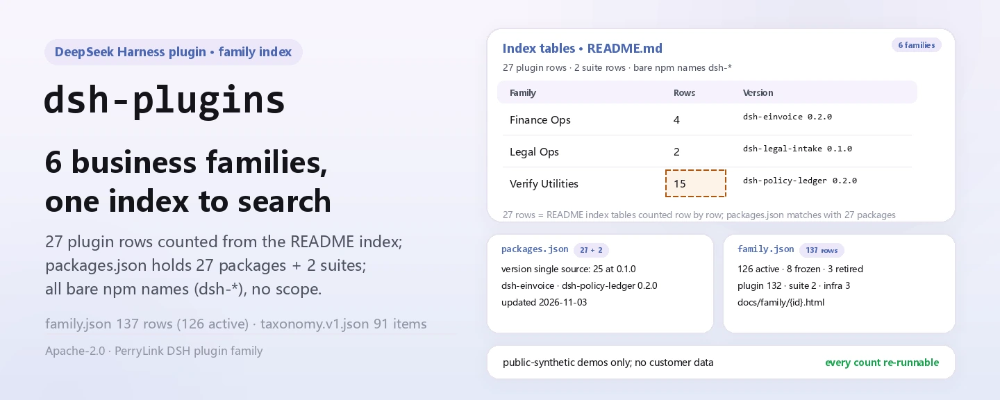
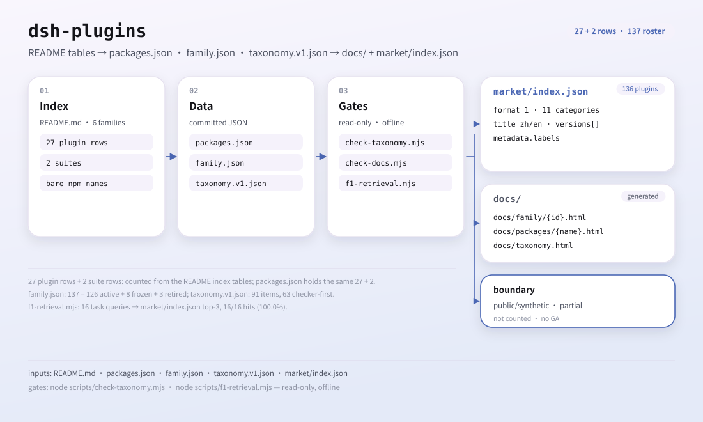
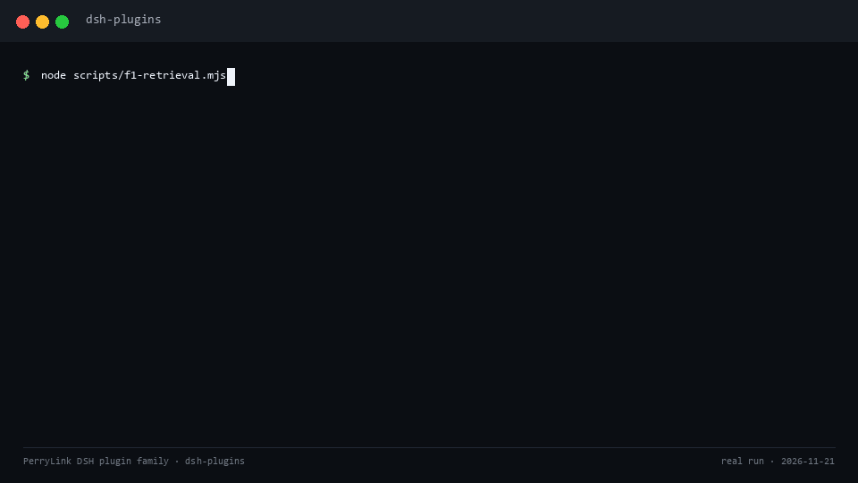

<picture>
  <source media="(prefers-color-scheme: dark)" srcset="docs/assets/dsh-plugins-hero-en-dark.webp">
  
</picture>

# PerryLink DSH domain plugins

**O índice da família de plugins DSH da PerryLink: 27 pacotes de domínio + 2 suítes de instalação em um único comando, em 6 famílias de negócio e com nomes npm sem escopo (`dsh-*`).**

*Esta é a entrada em português; a tabela completa com os 27 plugins, suas versões e comandos de instalação está no [README.md](README.md) em chinês, e a versão completa em inglês no [README.en.md](README.en.md).*

[English](README.en.md) · [简体中文](README.md) · [Español](README-es.md) · [Português](README-pt.md) · [हिन्दी](README-hi.md)

<picture>
  <source media="(prefers-color-scheme: dark)" srcset="docs/assets/dsh-plugins-flow-v5-dark.svg">
  
</picture>

*Estrutura: tabelas do índice → JSON versionados → docs/ e market/index.json → portões somente leitura. Os rótulos do diagrama são os nomes reais de arquivos e scripts, então a mesma imagem serve aos cinco idiomas.*

*Animado: o stdout real do experimento de recuperação somente leitura do repositório, `node scripts/f1-retrieval.mjs` (repetição de 2026-11-21) — 16 perguntas sobre os 136 plugins do `market/index.json`, taxa de acerto 16/16 (100,0%). Sem rede e sem chamadas ao modelo.*

## Instalação

Adicione um plugin pelo nome npm: `dsh plugin --profile <profile> add dsh-ghg`. Requer DSH `>=0.2.1-rc.3 <0.3.0` e Node `>=24.9 <25`.

## Índice

Os 27 pacotes de domínio estão agrupados em 6 famílias de negócio: Finance Ops (`dsh-einvoice`, `dsh-bankrec`, `dsh-ap-three-way`, `dsh-travel-recon`), Legal Ops (`dsh-legal-intake`, `dsh-legal-clause`), ESG & Quality (`dsh-ghg`, `dsh-qms-capa`), Trade & Logistics (`dsh-hs-candidate`, `dsh-freight-audit`), Docs & Models (`dsh-docx-redline`, `dsh-ifc-qto`) e Verify Utilities (15 pacotes). A tabela completa, com o link e a versão de cada pacote, está no [README.md](README.md).

## Artigo de cenário

- [De faturas a viagens: como funciona uma cadeia de operações financeiras auditável](https://perrylink.github.io/dsh-plugins/articles/finops-suite.html)

## Suítes em um único comando

Duas suítes instalam o conjunto de uma vez: `dsh-finops-suite` (`0.1.0-alpha.10`: `dsh-einvoice` + `dsh-bankrec` + `dsh-ap-three-way` + `dsh-travel-recon`) e `dsh-contract-suite` (`0.1.0-alpha.9`: `dsh-legal-intake` + `dsh-legal-clause`). Os comandos e os espelhos Gitee / GitCode estão no [README.md](README.md).

## Plataformas

GitHub ([PerryLink/dsh-plugins](https://github.com/PerryLink/dsh-plugins)), npm ([~perrylink](https://www.npmjs.com/~perrylink)), Gitee ([perrylink/dsh-plugins](https://gitee.com/perrylink/dsh-plugins)), GitCode ([PerryLink/dsh-plugins](https://gitcode.com/PerryLink/dsh-plugins)) e a documentação em [perrylink.github.io/dsh-plugins](https://perrylink.github.io/dsh-plugins/).

## Notas de nomes

Todos os pacotes usam nomes npm sem escopo. O nome original `dsh-eval-harness` está ocupado por outro publicador, então o projeto agora é **`dsh-eval-pack`** e o pacote com escopo `@perrylink/dsh-eval-harness` está obsoleto e aponta para o novo.

## Limites

Tudo é public/synthetic, partial, `counted=false` e sem GA; dados de clientes não entram no repositório, nos testes nem nos fixtures (apenas amostras públicas MIT/Apache), e alpha nunca é descrito como production-ready, validado por clientes ou de precisão comprovada. Apache-2.0; veja [PUBLIC-ONLY-BOUNDARY.md](PUBLIC-ONLY-BOUNDARY.md).
