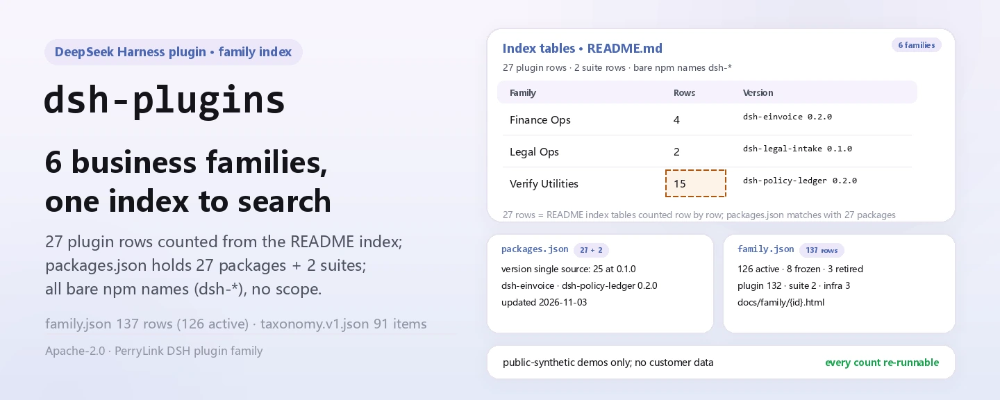
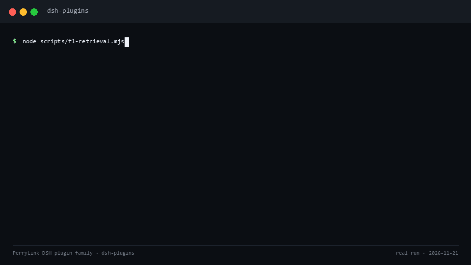
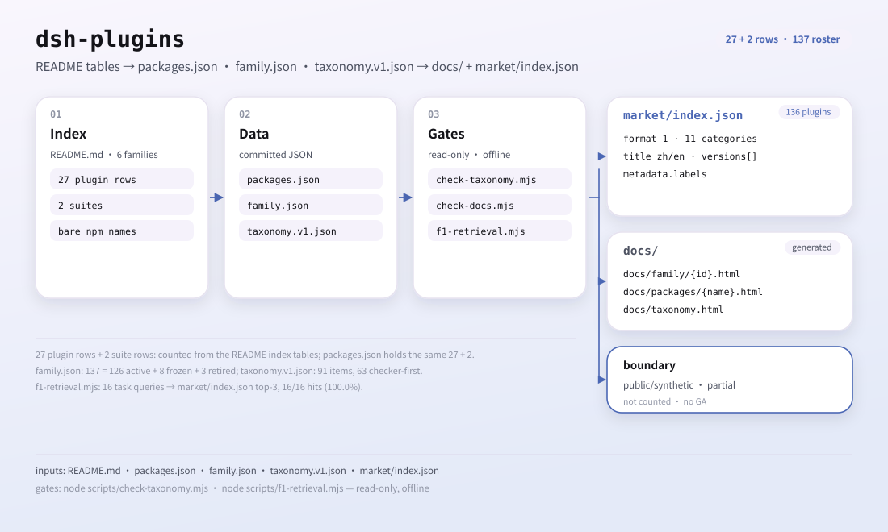

<div align="center">

<picture>
  <source media="(prefers-color-scheme: dark)" srcset="docs/assets/dsh-plugins-hero-en-dark.webp">
  
</picture>

# PerryLink DSH domain plugins

**The index of the PerryLink DSH plugin family: 27 domain packages + 2 one-command suites across 6 business families, all under bare npm names `dsh-*`.**

*The README.md index tables are the entry point, `packages.json` and `family.json` are the data sources, and `market/index.json` is what DSH Desktop's Discover tab reads; this repository lists public synthetic demos only — no customer data and no production-ready claim.*

[English](README.en.md) · [简体中文](README.md) · [Español](README-es.md) · [Português](README-pt.md) · [हिन्दी](README-hi.md)

[](LICENSE)
[](https://gitee.com/perrylink/dsh-plugins)

</div>

> **Status: alpha / public-synthetic / partial / not counted / not GA.** The full family grouping lives in [FAMILY.md](https://github.com/PerryLink/PerryLink/blob/main/FAMILY.md); the four-axis taxonomy is in [TAXONOMY.md](TAXONOMY.md); a filterable view of 137 rows (126 active) is in [taxonomy.html](docs/taxonomy.html). This index lists public synthetic demos only; there is no customer evidence, customer data or production-ready claim. SKU-11/14 are permanently DROPped.

27 DSH domain plugins, all under **bare npm names** (`dsh-*`), organised into 6 business families.

## Install



*Animated: the real stdout of the repository's own read-only retrieval experiment `node scripts/f1-retrieval.mjs` (re-run 2026-11-21) — 16 task questions over the 136 plugins in `market/index.json`, hit rate 16/16 (100.0%). No network, no model call.*

```sh
dsh plugin --profile <profile> add dsh-ghg
```

Requires DSH `>=0.2.1-rc.3 <0.3.0` and Node `>=24.9 <25`.

<picture>
  <source media="(prefers-color-scheme: dark)" srcset="docs/assets/dsh-plugins-flow-v5-dark.svg">
  
</picture>

*Structure: index tables → committed JSON → docs/ and market/index.json → read-only gates. The token labels inside the diagram are the real file and script names, so the same picture serves all five languages.*

## Index

### Finance Ops

| Package | Purpose | Version | Install |
|---|---|---:|---|
| [`dsh-einvoice`](https://github.com/PerryLink/dsh-einvoice) | File-level China e-invoice (OFD/XML) ingest, parsing, dedupe and local archive. | `0.2.0` | `dsh plugin --profile <profile> add dsh-einvoice` |
| [`dsh-bankrec`](https://github.com/PerryLink/dsh-bankrec) | Bank statement / GL / CAMT.053 / MT940 ingest, reconciliation and a three-statement working paper. | `0.1.0` | `dsh plugin --profile <profile> add dsh-bankrec` |
| [`dsh-ap-three-way`](https://github.com/PerryLink/dsh-ap-three-way) | Invoice / PO / GRN three-way match, tolerances and an exception working paper. | `0.1.0` | `dsh plugin --profile <profile> add dsh-ap-three-way` |
| [`dsh-travel-recon`](https://github.com/PerryLink/dsh-travel-recon) | Travel booking / invoice / card-statement reconciliation, dedupe and a read-only policy check. | `0.1.0` | `dsh plugin --profile <profile> add dsh-travel-recon` |

### Legal Ops

| Package | Purpose | Version | Install |
|---|---|---:|---|
| [`dsh-legal-intake`](https://github.com/PerryLink/dsh-legal-intake) | Legal-request EML intake, thread dedupe and ledger export. | `0.1.0` | `dsh plugin --profile <profile> add dsh-legal-intake` |
| [`dsh-legal-clause`](https://github.com/PerryLink/dsh-legal-clause) | Contract clause tree, playbook mapping and an open-issues report. | `0.1.0` | `dsh plugin --profile <profile> add dsh-legal-clause` |

### ESG & Quality

| Package | Purpose | Version | Install |
|---|---|---:|---|
| [`dsh-ghg`](https://github.com/PerryLink/dsh-ghg) | Electricity-activity ingest, GHG calculation, row-by-row recomputation, a working paper and a partial ESRS package. | `0.1.0` | `dsh plugin --profile <profile> add dsh-ghg` |
| [`dsh-qms-capa`](https://github.com/PerryLink/dsh-qms-capa) | QMS NCR ingest, batch aliases, impact assessment, CAPA and 8D. | `0.1.0` | `dsh plugin --profile <profile> add dsh-qms-capa` |

### Trade & Logistics

| Package | Purpose | Version | Install |
|---|---|---:|---|
| [`dsh-hs-candidate`](https://github.com/PerryLink/dsh-hs-candidate) | HS Top-3 candidates, 12-element completeness, RVC and tariff-version gates. | `0.1.0` | `dsh plugin --profile <profile> add dsh-hs-candidate` |
| [`dsh-freight-audit`](https://github.com/PerryLink/dsh-freight-audit) | Freight ratecard versions, bill audit, recovery summary and variance export. | `0.1.0` | `dsh plugin --profile <profile> add dsh-freight-audit` |

### Docs & Models

| Package | Purpose | Version | Install |
|---|---|---:|---|
| [`dsh-docx-redline`](https://github.com/PerryLink/dsh-docx-redline) | DOCX structure check, byte-for-byte roundtrip and single-run text replacement. | `0.1.0` | `dsh plugin --profile <profile> add dsh-docx-redline` |
| [`dsh-ifc-qto`](https://github.com/PerryLink/dsh-ifc-qto) | IFC component / bill-of-quantities extraction with CSV export. | `0.1.0` | `dsh plugin --profile <profile> add dsh-ifc-qto` |

### Verify Utilities

| Package | Purpose | Version | Install |
|---|---|---:|---|
| [`dsh-policy-ledger`](https://github.com/PerryLink/dsh-policy-ledger) | Read-only install diagnostics: capability snapshot, tarball assertions and install-log classification. | `0.2.0` | `dsh plugin --profile <profile> add dsh-policy-ledger` |
| [`dsh-pim-lint`](https://github.com/PerryLink/dsh-pim-lint) | PIM catalogue lint: required fields, duplicate SKUs, GTIN check digits and prices. | `0.1.0` | `dsh plugin --profile <profile> add dsh-pim-lint` |
| [`dsh-eval-pack`](https://github.com/PerryLink/dsh-eval-pack) | Public/synthetic eval-pack lint and deterministic JSON scoring. | `0.1.0` | `dsh plugin --profile <profile> add dsh-eval-pack` |
| [`dsh-provider-params`](https://github.com/PerryLink/dsh-provider-params) | Vendor parameter conversion and deterministic JSON repair. | `0.1.0` | `dsh plugin --profile <profile> add dsh-provider-params` |
| [`dsh-store-replenish`](https://github.com/PerryLink/dsh-store-replenish) | Store replenishment advice: suggested quantity from sales, stock and in-transit, flagging stockout risk and slow movers. | `0.1.0` | `dsh plugin --profile <profile> add dsh-store-replenish` |
| [`dsh-attendance-check`](https://github.com/PerryLink/dsh-attendance-check) | Attendance and overtime check: import clock records, compare against standard hours and overtime caps, flag overtime, missing punches and insufficient rest. | `0.1.0` | `dsh plugin --profile <profile> add dsh-attendance-check` |
| [`dsh-settlement-docs`](https://github.com/PerryLink/dsh-settlement-docs) | Completion-settlement document completeness: build the document checklist by project type, check missing items, copy counts, signatures and seals, and report the completeness rate. | `0.1.0` | `dsh plugin --profile <profile> add dsh-settlement-docs` |
| [`dsh-ar-collection`](https://github.com/PerryLink/dsh-ar-collection) | Accounts-receivable collection: generate collection plans and Chinese dunning-letter drafts by aging bucket, and export the collection list. | `0.1.0` | `dsh plugin --profile <profile> add dsh-ar-collection` |
| [`dsh-import-customs-check`](https://github.com/PerryLink/dsh-import-customs-check) | Import document check: compare the nine fields of the invoice, packing list, bill of lading and customs declaration, and check the 12 declaration elements for completeness. | `0.1.0` | `dsh plugin --profile <profile> add dsh-import-customs-check` |
| [`dsh-ar-aging`](https://github.com/PerryLink/dsh-ar-aging) | AR aging: import receivable details, bucket by aging, summarise overdue amounts and top customers, and export the aging table. | `0.1.0` | `dsh plugin --profile <profile> add dsh-ar-aging` |
| [`dsh-progress-payment`](https://github.com/PerryLink/dsh-progress-payment) | Progress-payment review: check the current progress claim against contracted quantity and unit price, flagging excess quantity, unit-price mismatch and duplicate line items. | `0.1.0` | `dsh plugin --profile <profile> add dsh-progress-payment` |
| [`dsh-labor-contract`](https://github.com/PerryLink/dsh-labor-contract) | Labour-contract check: verify mandatory clauses, probation limits and wage ratios, and flag problem contracts in bulk. | `0.1.0` | `dsh plugin --profile <profile> add dsh-labor-contract` |
| [`dsh-rfq-compare`](https://github.com/PerryLink/dsh-rfq-compare) | RFQ comparison: import multiple quotes, compare per item, and flag quotes below cost, over budget and expired. | `0.1.0` | `dsh plugin --profile <profile> add dsh-rfq-compare` |
| [`dsh-contract-renewal`](https://github.com/PerryLink/dsh-contract-renewal) | Contract renewal: record contract start/end and renewal windows, list contracts expiring soon or already expired, and export CSV. | `0.1.0` | `dsh plugin --profile <profile> add dsh-contract-renewal` |
| [`dsh-pdf-table`](https://github.com/PerryLink/dsh-pdf-table) | Extract PDF text-layer tables to CSV (scanned documents need OCR first). | `0.1.0` | `dsh plugin --profile <profile> add dsh-pdf-table` |

The two suites also have Gitee / GitCode mirrors: [dsh-finops-suite](https://gitee.com/perrylink/dsh-finops-suite) / [dsh-contract-suite](https://gitee.com/perrylink/dsh-contract-suite).

## Scenario article

- [From invoices to travel: how a reviewable finance-ops chain runs](https://perrylink.github.io/dsh-plugins/articles/finops-suite.html)

## One-command suites

| Suite | Members | Version | Install |
|---|---|---:|---|
| [`dsh-finops-suite`](https://github.com/PerryLink/dsh-finops-suite) | `dsh-einvoice` + `dsh-bankrec` + `dsh-ap-three-way` + `dsh-travel-recon` | `0.1.0-alpha.10` | `dsh plugin --profile <profile> add dsh-finops-suite` |
| [`dsh-contract-suite`](https://github.com/PerryLink/dsh-contract-suite) | `dsh-legal-intake` + `dsh-legal-clause` | `0.1.0-alpha.9` | `dsh plugin --profile <profile> add dsh-contract-suite` |

## Platforms

| Platform | Address | Notes |
|---|---|---|
| GitHub | https://github.com/PerryLink/dsh-plugins | This index + the package repositories |
| npm | https://www.npmjs.com/~perrylink | The bare-name `dsh-*` packages |
| Gitee | https://gitee.com/perrylink/dsh-plugins | Chinese index + 5 flagship mirrors |
| GitCode | https://gitcode.com/PerryLink/dsh-plugins | Chinese index + 3 flagship mirrors |
| Docs | https://perrylink.github.io/dsh-plugins/ | Package pages + the index |

## Naming notes

- All packages use bare names; the `@perrylink/` scope is no longer used.
- The original bare name `dsh-eval-harness` is held by another publisher, so the project is now **`dsh-eval-pack`**; the old scoped package `@perrylink/dsh-eval-harness` is deprecated and points at the new package.
- The old scoped packages have published final redirect READMEs and are `npm deprecate`d to the corresponding bare-name packages.

## Boundary

- Everything is public/synthetic, partial, `counted=false`, with no GA.
- Customer data must not enter the repository, tests or fixtures; only MIT/Apache public samples are accepted.
- Alpha is never described as production-ready, customer-validated or accuracy-proven.

Apache-2.0. See [PUBLIC-ONLY-BOUNDARY.md](PUBLIC-ONLY-BOUNDARY.md) for details.
